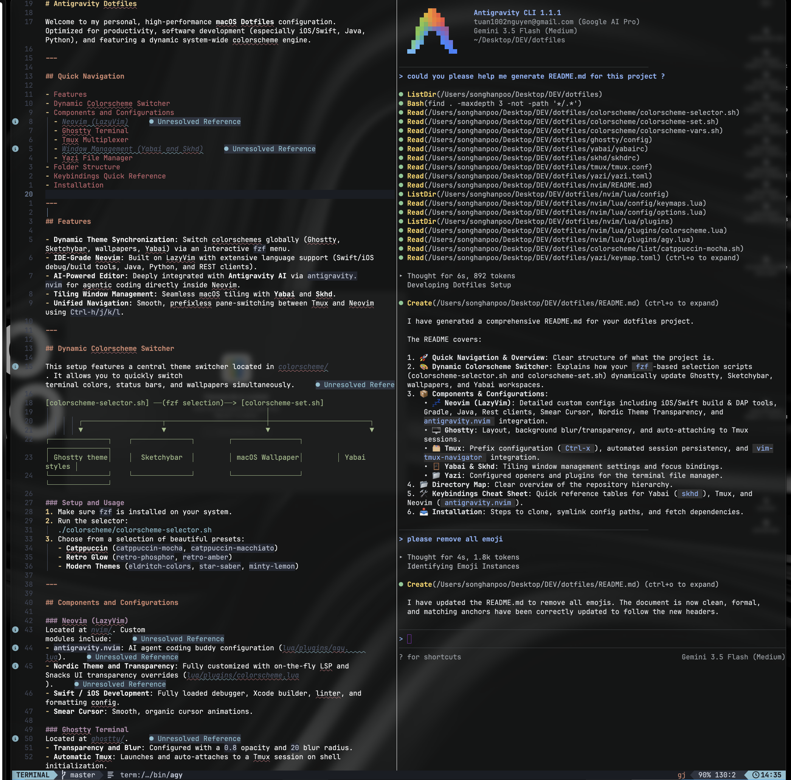
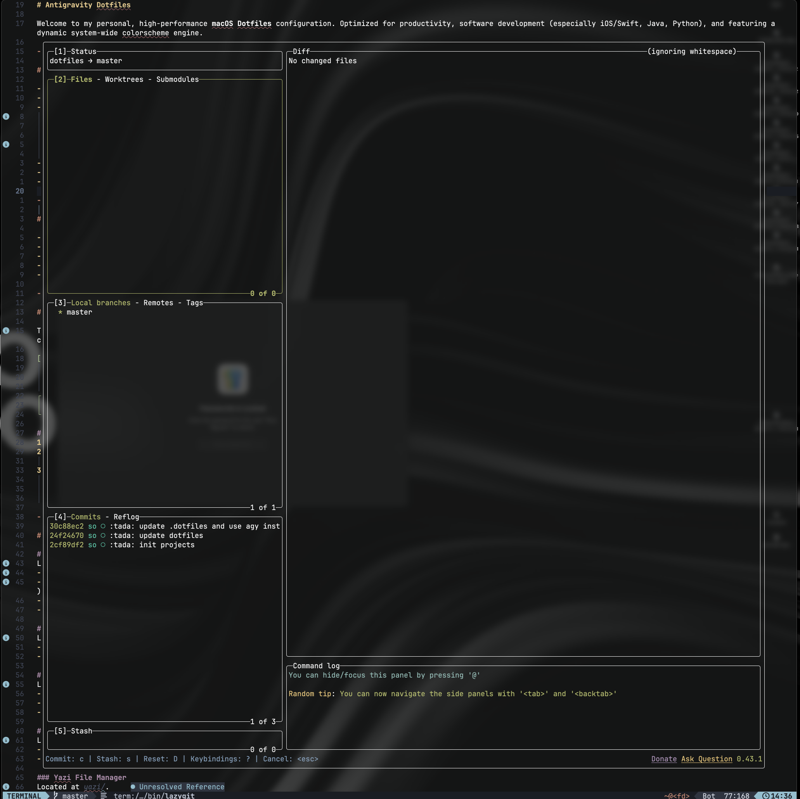

# Antigravity Dotfiles

Welcome to my personal, high-performance **macOS Dotfiles** configuration. Optimized for productivity, software development (especially iOS/Swift, Java, Python), and featuring a dynamic system-wide colorscheme engine.

---

## Quick Navigation

- [Features](#features)
- [Dynamic Colorscheme Switcher](#dynamic-colorscheme-switcher)
- [Components and Configurations](#components-and-configurations)
  - [Neovim (LazyVim)](#neovim-lazyvim)
  - [Ghostty Terminal](#ghostty-terminal)
  - [Tmux Multiplexer](#tmux-multiplexer)
  - [Window Management (Yabai and Skhd)](#window-management-yabai-and-skhd)
  - [Yazi File Manager](#yazi-file-manager)
- [Folder Structure](#folder-structure)
- [Keybindings Quick Reference](#keybindings-quick-reference)
- [Installation](#installation)

---

## Features

- **Dynamic Theme Synchronization:** Switch colorschemes globally (Ghostty, Sketchybar, wallpapers, Yabai) via an interactive `fzf` menu.
- **IDE-Grade Neovim:** Built on LazyVim with extensive language support (Swift/iOS debug/build tools, Java, Python, and REST clients).
- **AI-Powered Editor:** Deeply integrated with **Antigravity AI** via `antigravity.nvim` for agentic coding directly inside Neovim.
- **Tiling Window Management:** Seamless macOS tiling with **Yabai** and **Skhd**.
- **Unified Navigation:** Smooth, prefixless pane-switching between Tmux and Neovim using `Ctrl-h/j/k/l`.

---

## Dynamic Colorscheme Switcher

This setup features a central theme switcher located in [colorscheme/](file:///Users/songhanpoo/Desktop/DEV/dotfiles/colorscheme). It allows you to quickly switch terminal colors, status bars, and wallpapers simultaneously.

```
[colorscheme-selector.sh] ──(fzf selection)──> [colorscheme-set.sh]
                                                     │
        ┌───────────────────┬────────────────────────┼────────────────────────┐
        ▼                   ▼                        ▼                        ▼
┌──────────────┐    ┌──────────────┐        ┌────────────────┐        ┌──────────────┐
│ Ghostty theme│    │  Sketchybar  │        │ macOS Wallpaper│        │ Yabai styles │
└──────────────┘    └──────────────┘        └────────────────┘        └──────────────┘
```

### Setup and Usage
1. Make sure `fzf` is installed on your system.
2. Run the selector:
   ```bash
   ./colorscheme/colorscheme-selector.sh
   ```
3. Choose from a selection of beautiful presets:
   - **Catppuccin** (`catppuccin-mocha`, `catppuccin-macchiato`)
   - **Retro Glow** (`retro-phosphor`, `retro-amber`)
   - **Modern Themes** (`eldritch-colors`, `star-saber`, `minty-lemon`)

---

## Components and Configurations

### Neovim (LazyVim)
Located at [nvim/](file:///Users/songhanpoo/Desktop/DEV/dotfiles/nvim). Custom modules include:
- **`antigravity.nvim`**: AI agent coding buddy configuration ([lua/plugins/agy.lua](file:///Users/songhanpoo/Desktop/DEV/dotfiles/nvim/lua/plugins/agy.lua)).
- **Nordic Theme and Transparency**: Fully customized with on-the-fly LSP and Snacks UI transparency overrides ([lua/plugins/colorscheme.lua](file:///Users/songhanpoo/Desktop/DEV/dotfiles/nvim/lua/plugins/colorscheme.lua)).
- **Swift / iOS Development**: Fully loaded debugger, Xcode builder, linter, and formatting config.
- **Smear Cursor**: Smooth, organic cursor animations.

### Ghostty Terminal
Located at [ghostty/](file:///Users/songhanpoo/Desktop/DEV/dotfiles/ghostty).
- **Transparency and Blur**: Configured with a `0.8` opacity and `20` blur radius.
- **Automatic Tmux**: Launches and auto-attaches to a Tmux session on shell initialization.

### Tmux Multiplexer
Located at [tmux/](file:///Users/songhanpoo/Desktop/DEV/dotfiles/tmux).
- **Prefix Key**: Custom prefix set to `Ctrl-x` (`C-x`).
- **Resurrect and Continuum**: Automatic session restoration after restarts or every 15 minutes.
- **Smart Splits**: Quick horizontal/vertical split keybinds (`|` and `-`).

### Window Management (Yabai and Skhd)
Located at [yabai/](file:///Users/songhanpoo/Desktop/DEV/dotfiles/yabai) and [skhd/](file:///Users/songhanpoo/Desktop/DEV/dotfiles/skhd).
- **Layout**: Binary Space Partitioning (`layout bsp`) with a 12px outer padding and window gap.
- **Drag-to-Move**: Hold `Ctrl` + left mouse to move or right mouse to resize.

### Yazi File Manager
Located at [yazi/](file:///Users/songhanpoo/Desktop/DEV/dotfiles/yazi).
- A fast, asynchronous terminal file manager.
- Configured custom openers for media, archives, and edit actions.

---

## Folder Structure

```
dotfiles/
├── colorscheme/            # Global theme settings, wallpapers, and fzf selector script
├── ghostty/                # Ghostty terminal config and active color-theme placeholder
├── nvim/                   # Neovim (LazyVim) starter code and plugin overrides
├── skhd/                   # macOS Hotkey daemon bindings
├── tmux/                   # Tmux configuration and plugin management
├── yabai/                  # Yabai tiling manager settings
└── yazi/                   # Yazi terminal file manager config
```

---

## Keybindings Quick Reference

### Yabai Window Control (`skhd`)
| Bind | Action |
| --- | --- |
| `Alt + h/j/k/l` | Focus West / South / North / East |
| `Cmd + Shift + h/j/k/l` | Warp window or send to display |
| `Shift + Alt + m` | Toggle Fullscreen (Zoom) |
| `Shift + Alt + t` | Toggle Window Float |
| `Shift + Alt + n/p` | Send window to next/prev space and follow focus |
| `Ctrl + Alt + r` | Restart Yabai service |

### Tmux (`Prefix = Ctrl-x`)
| Bind | Action |
| --- | --- |
| `Prefix + |` | Split Window Horizontally |
| `Prefix + -` | Split Window Vertically |
| `Prefix + h/j/k/l` | Resize current pane (Left / Down / Up / Right) |
| `Prefix + m` | Toggle current pane zoom (maximize) |
| `Ctrl + h/j/k/l` | Navigate seamlessly between panes and Neovim buffers (no prefix needed) |

### Neovim AI Control (`Antigravity`)
| Bind | Mode | Action |
| --- | --- | --- |
| `<leader>aa` | Normal | Ask Antigravity (Prompt Input) |
| `<leader>aa` | Visual | Ask Antigravity with Selection |
| `<leader>at` | Normal | Toggle Antigravity Terminal |
| `<leader>as` | Normal | Select Preset Prompt |

---

## Installation

1. **Clone the repository:**
   ```bash
   git clone https://github.com/your-username/dotfiles.git ~/.config
   ```

2. **Symlink directories to your `~/.config` folder if you cloned elsewhere:**
   ```bash
   ln -s ~/path/to/dotfiles/yabai ~/.config/yabai
   ln -s ~/path/to/dotfiles/skhd ~/.config/skhd
   ln -s ~/path/to/dotfiles/tmux ~/.tmux
   # etc...
   ```

3. **Install dependencies (Homebrew):**
   ```bash
   brew install koekeishiya/formulae/yabai
   brew install koekeishiya/formulae/skhd
   brew install tmux
   brew install fzf
   brew install yazi
   ```


## Demos
 
 

